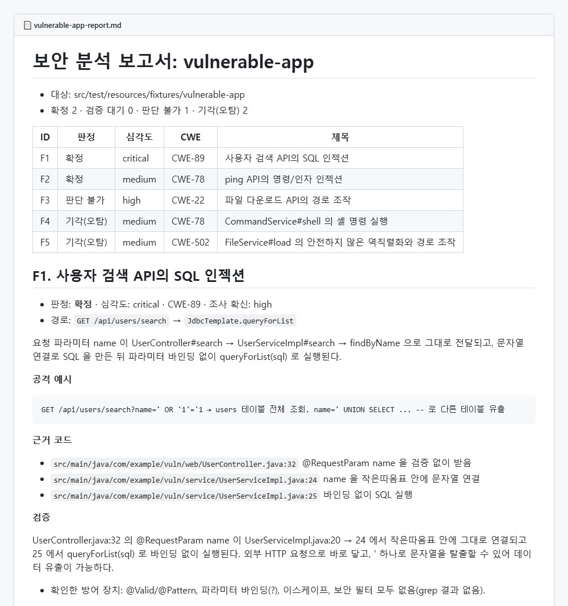

# mcp-code-agent

**An AI code security audit agent you run from chat (Claude Code plugin + MCP server)**

[English](#english) · [한국어](#한국어)

<a id="english"></a>

Connect it to Claude Code (or Claude Desktop) and say *"audit this repository for security issues"*. Claude uses this server's tools to follow **entry point → dangerous API (sink)** paths through Java/Spring code, records vulnerabilities, re-verifies each one from the opposite side, and writes a report.

- **Runs on your Claude Code login.** A Claude subscription (Pro, Max, Team, …) or an API key, whichever Claude Code uses. There is no separate API key to configure.
- **No database, no server to host.** Only Java is required. The code graph lives in memory and findings are saved as JSON files.
- A **standalone version** of [be-code-agent](https://github.com/yeomyaloo/be-code-agent) (Spring Boot backend + PostgreSQL + Anthropic API) that shares the same code graph engine.

## How it works: Claude is the brain, the MCP server is the hands

```
 ┌──────────── Chat app (Claude Code / Claude Desktop) ────────────┐
 │  Claude = brain                                                  │
 │  · decides which paths to investigate and which files to read    │
 │  · judges whether code is exploitable (worker role)              │
 │  · switches sides and re-verifies each finding (verifier role)   │
 └────────────────┬──────────────────────────────────▲──────────────┘
                  │ tool calls (MCP over stdio)        │ text results
 ┌────────────────▼──────────────────────────────────┴──────────────┐
 │  mcp-code-agent = hands                                           │
 │  · code graph: entry points, sinks, call edges (JavaParser)       │
 │  · file read / grep, scoped to the repository                     │
 │  · findings and verdicts (~/.mcp-code-agent/findings/*.json)      │
 │  · reports (Markdown, SARIF 2.1.0)                                │
 └───────────────────────────────────────────────────────────────────┘
```

| | be-code-agent | mcp-code-agent |
|---|---|---|
| Brain (LLM) | The backend calls the Anthropic API (API key) | Claude in your chat app (subscription or API key login) |
| Agent loop | Backend `AgentLoop` | The chat app |
| Planner / Worker / Verifier | Separate agents run by the backend | Claude takes each role in turn (Claude Code can split them into subagents) |
| Storage | PostgreSQL | Memory + JSON files |
| UI | Web ([fe-code-agent](https://github.com/yeomyaloo/fe-code-agent)) | The chat window |

## Install

**Requirement: Java 17 or later** on your `PATH` (check with `java -version`).

### Claude Code plugin (recommended)

```bash
claude plugin marketplace add yeomyaloo/mcp-code-agent
claude plugin install code-agent@yeomyaloo-code-agent
```

Or inside a Claude Code session:

```
/plugin marketplace add yeomyaloo/mcp-code-agent
/plugin install code-agent@yeomyaloo-code-agent
```

Start a new session (or run `/reload-plugins`). The plugin brings:

- the **`code-agent` MCP server** with 15 tools (prebuilt in `server/lib`, no build step), and
- the **`security-audit` skill**, which guides the audit: plan → investigate → verify → report.

**You do not start any server yourself.** Claude Code launches the MCP server (a small Java process) in the background when a session starts and stops it when the session ends.

To check the connection, run `/mcp` inside Claude Code: `plugin:code-agent:code-agent` should show as connected. If it shows as failed, Claude Code usually could not find `java`: install Java 17 or later, make sure `java -version` works in a new terminal, then restart Claude Code.

Update later with `claude plugin update code-agent@yeomyaloo-code-agent`.

> Looking for the web UI instead? That is a different setup with a real server (PostgreSQL + backend + web UI) started by `docker compose up`, and it needs an Anthropic API key. See [be-code-agent](https://github.com/yeomyaloo/be-code-agent#quick-start-with-docker-recommended).

### Claude Desktop (manual)

Claude Desktop's chat does not load plugin-provided local MCP servers, so add the server yourself. Clone this repository, then open Settings → Developer → Edit Config, add the following to `claude_desktop_config.json`, and restart the app:

```json
{
  "mcpServers": {
    "code-agent": {
      "command": "java",
      "args": ["-Dfile.encoding=UTF-8", "-cp", "C:/path/to/mcp-code-agent/server/lib/*", "com.codeagent.mcp.McpCodeAgent"]
    }
  }
}
```

### Claude Code without the plugin (manual)

```bash
claude mcp add code-agent --scope user -- java -Dfile.encoding=UTF-8 -cp "C:/path/to/mcp-code-agent/server/lib/*" com.codeagent.mcp.McpCodeAgent
```

## Usage

Just ask in chat:

```
Audit https://github.com/spring-projects/spring-petclinic for security vulnerabilities
```

```
Find only SQL injection in C:/work/my-api
```

With the plugin, the `security-audit` skill kicks in for requests like these. You can also call it directly with `/code-agent:security-audit`. The MCP server also exposes two prompts, `security_audit` (target, max_paths) and `verify_findings` (repo).

### Example result

A real run of this MCP server from Claude Code (`claude -p`) against the deliberately vulnerable test app (`src/test/resources/fixtures/vulnerable-app`). It took 27 turns, about one minute.

- Claude investigated the entry point → sink paths and the sinks no entry point reaches, and recorded 5 findings.
- It then switched sides and re-verified them:
  - **2 confirmed**: SQL injection, command argument injection
  - **1 uncertain**: path traversal; whether it is blocked depends on server settings outside the repository
  - **2 rejected**: dangerous code that nothing calls



Full report: [Markdown](docs/examples/vulnerable-app-report.md) · [image](docs/images/report-example.png) (the report text is in Korean because the run was in Korean; Claude answers in your language)

## Tools

| Tool | What it does | Read-only |
|---|---|---|
| `load_repository` | Load a folder path or a public Git https URL (shallow clone) and build the code graph | |
| `list_repositories` | Loaded repositories | ✅ |
| `list_sink_paths` | Entry point → sink call paths (shortest per pair, shortest first) | ✅ |
| `list_entry_points` | Spring MVC HTTP entry points | ✅ |
| `list_sinks` | Sinks: SQL, COMMAND, PATH, DESERIALIZATION, SSRF, CODE_INJECTION, EXPRESSION_INJECTION, JNDI, OPEN_REDIRECT, and IDOR (Spring Data `findById` / `deleteById`-style access by id, a missing-owner-check candidate; owner-scoped queries like `findByIdAndUser` are excluded) | ✅ |
| `find_code_nodes` | Find classes, methods, entry points and sinks by name | ✅ |
| `get_callers` / `get_callees` | Who calls this / what this calls (interface → implementation included) | ✅ |
| `read_file` | Read a file with line numbers (400 lines per call) | ✅ |
| `grep_code` | Regex search (look for defenses) | ✅ |
| `record_finding` | Record a vulnerability (file:line evidence required; pending verification) | |
| `submit_verdict` | Verdict for a finding: confirmed / rejected / uncertain | |
| `list_findings` | Findings, ordered by verdict and severity | ✅ |
| `export_report` | Save a Markdown or SARIF 2.1.0 report | |
| `clear_findings` | Delete all findings of a repository | |

## Configuration

| Environment variable | Default | Description |
|---|---|---|
| `MCP_CODE_AGENT_HOME` | `~/.mcp-code-agent` | Where clones (`repos/`), findings (`findings/`) and reports (`reports/`) go |
| `MCP_CODE_AGENT_GIT_HOSTS` | `github.com,gitlab.com,bitbucket.org` | Hosts allowed for cloning |

## Security

- **Git clone**: https and allowed hosts only; hosts that resolve to private networks are refused (SSRF protection). Only the latest commit, no submodules; symlinks pointing outside the repository are removed. Size limit 500 MB.
- **File access**: `read_file`, `grep_code` and `record_finding` only touch files inside the loaded repository (`../` and symlinks are blocked).
- **No code execution**: target code is only read, never built or run.
- **Plugin**: like every Claude Code plugin, the MCP server runs with your user privileges. The bundled jars are listed in [server/THIRD-PARTY.md](server/THIRD-PARTY.md).

## Development

```bash
./gradlew test           # tests (no DB, network or API key)
./gradlew pluginServer   # rebuild server/lib for the plugin
./gradlew installDist    # launch scripts in build/install/mcp-code-agent/bin
```

When you change code, run `./gradlew pluginServer`, commit `server/lib`, and bump `version` in `.claude-plugin/plugin.json` so installed plugins update.

- `CodeAgentToolsTest`: each tool's output, input errors, finding storage and reports
- `McpProtocolTest`: starts the server as a separate process with the SDK's MCP client and calls tools and prompts over real stdio

```
.claude-plugin/
├── plugin.json               plugin manifest + MCP server declaration
└── marketplace.json          makes this repository a plugin marketplace
skills/security-audit/        audit workflow skill
server/lib/                   prebuilt server and dependencies (./gradlew pluginServer)
src/main/java/com/codeagent/mcp/
├── McpCodeAgent.java         entry point: stdio MCP server, tool and prompt registration
├── Prompts.java              security_audit, verify_findings prompts and server instructions
├── codegraph/                code graph (same engine as be-code-agent codegraph/ingest)
│   └── CodeGraph.java        in-memory graph, path search (BFS), call queries
├── source/                   Git URL policy, shallow clone
├── workspace/                settings, loaded repositories
├── findings/                 findings, JSON storage, reports
└── tools/                    MCP tool definitions, argument checks, file access
```

## Limitations

- Analyzes Java / Spring MVC code only.
- The code graph is static analysis and can be wrong, which is why Claude must read the actual code before judging.
- The analyzed code is sent to Anthropic through your chat app. Do not analyze code that must not leave your machine.
- Meant for each person to use in their own chat app, not to be offered to others as a service.
- Claude Desktop chat cannot install it as a plugin (manual setup above).

## License

[Apache License 2.0](LICENSE)

---

<a id="한국어"></a>

# mcp-code-agent (한국어)

**채팅에서 쓰는 AI 코드 보안 분석 에이전트 (Claude Code 플러그인 + MCP 서버)**

Claude Code나 Claude Desktop에 연결하고 "이 저장소 보안 분석해줘"라고 하면 된다. Claude가 이 서버의 도구로 Java/Spring 코드의 **진입점 → 위험 지점** 경로를 따라가며 취약점을 찾고, 입장을 바꿔 다시 검증하고, 보고서를 만든다.

- **Claude Code에 로그인한 그대로 돈다.** Claude 구독(Pro, Max, Team 등)이든 API 키든 Claude Code가 쓰는 방식 그대로이고, 따로 설정할 API 키가 없다.
- **DB도 서버도 필요 없다.** Java만 있으면 된다. 코드 그래프는 메모리에, 발견은 JSON 파일에 둔다.
- [be-code-agent](https://github.com/yeomyaloo/be-code-agent)(Spring Boot 백엔드 + PostgreSQL + Anthropic API)와 같은 코드 그래프 엔진을 쓰는 **독립 버전**이다.

## 구조: Claude는 두뇌, MCP 서버는 손발

```
 ┌─────────── 채팅 앱 (Claude Code / Claude Desktop) ───────────┐
 │  Claude = 두뇌                                                │
 │  · 어떤 경로를 조사할지, 어떤 파일을 읽을지 정한다              │
 │  · 취약한지 판단한다 (Worker 역할)                             │
 │  · 입장을 바꿔 다시 검증한다 (Verifier 역할)                   │
 └───────────────┬───────────────────────────────▲──────────────┘
                 │ 도구 호출 (MCP, 표준 입출력)    │ 결과 텍스트
 ┌───────────────▼───────────────────────────────┴──────────────┐
 │  mcp-code-agent = 손발                                       │
 │  · 코드 그래프: JavaParser 로 진입점·위험 지점·호출 관계 추출   │
 │  · 파일 읽기·검색 (저장소 밖 접근 차단)                        │
 │  · 발견 기록·판정 저장 (~/.mcp-code-agent/findings/*.json)     │
 │  · 보고서 (Markdown, SARIF 2.1.0)                            │
 └──────────────────────────────────────────────────────────────┘
```

| | be-code-agent | mcp-code-agent |
|---|---|---|
| 두뇌(LLM) | 백엔드가 Anthropic API 호출 (API 키 필요) | 채팅 앱의 Claude (구독 또는 API 키로 로그인) |
| 반복 실행 | 백엔드 `AgentLoop` | 채팅 앱이 알아서 반복 |
| Planner / Worker / Verifier | 백엔드가 별도 에이전트로 실행 | 채팅의 Claude가 차례로 맡음 (Claude Code는 서브에이전트로 나눌 수 있음) |
| 저장 | PostgreSQL | 메모리 + JSON 파일 |
| 화면 | 웹 ([fe-code-agent](https://github.com/yeomyaloo/fe-code-agent)) | 채팅창 |

## 설치

**요구 사항: Java 17 이상**이 `PATH`에 있어야 한다 (`java -version`으로 확인).

### Claude Code 플러그인 (추천)

```bash
claude plugin marketplace add yeomyaloo/mcp-code-agent
claude plugin install code-agent@yeomyaloo-code-agent
```

Claude Code 대화 안에서는:

```
/plugin marketplace add yeomyaloo/mcp-code-agent
/plugin install code-agent@yeomyaloo-code-agent
```

새 대화를 열면(또는 `/reload-plugins`) 바로 쓸 수 있다. 플러그인에 들어 있는 것:

- **`code-agent` MCP 서버**와 도구 15개. `server/lib`에 미리 빌드돼 있어서 빌드할 필요가 없다.
- **`security-audit` 스킬**: 계획 → 조사 → 검증 → 보고 순서로 분석을 이끈다.

**서버를 직접 띄울 필요가 없다.** 대화를 시작하면 Claude Code가 MCP 서버(작은 Java 프로그램)를 백그라운드에서 알아서 실행하고, 대화가 끝나면 같이 끈다.

연결을 확인하려면 Claude Code 안에서 `/mcp`를 입력한다. `plugin:code-agent:code-agent`가 연결됨으로 보이면 정상이다. 실패로 나오면 대개 `java`를 못 찾은 것이다. Java 17 이상을 설치하고, 새 터미널에서 `java -version`이 되는지 확인한 뒤 Claude Code를 다시 켠다.

나중에 업데이트하려면 `claude plugin update code-agent@yeomyaloo-code-agent`.

> 웹 화면으로 쓰고 싶다면 설치 방식이 다르다. 진짜 서버(PostgreSQL + 백엔드 + 웹 화면)를 `docker compose up`으로 띄우고, Anthropic API 키가 필요하다. [be-code-agent](https://github.com/yeomyaloo/be-code-agent#docker로-한-번에-실행-추천) 참고.

### Claude Desktop (직접 설정)

Claude Desktop 채팅은 플러그인의 로컬 MCP 서버를 읽지 않아서 직접 등록해야 한다. 이 저장소를 클론한 뒤 설정 → 개발자 → 설정 편집에서 `claude_desktop_config.json`에 아래를 추가하고 앱을 다시 켠다.

```json
{
  "mcpServers": {
    "code-agent": {
      "command": "java",
      "args": ["-Dfile.encoding=UTF-8", "-cp", "C:/path/to/mcp-code-agent/server/lib/*", "com.codeagent.mcp.McpCodeAgent"]
    }
  }
}
```

### 플러그인 없이 Claude Code에 연결 (직접 설정)

```bash
claude mcp add code-agent --scope user -- java -Dfile.encoding=UTF-8 -cp "C:/path/to/mcp-code-agent/server/lib/*" com.codeagent.mcp.McpCodeAgent
```

## 사용법

채팅으로 말하면 된다.

```
https://github.com/spring-projects/spring-petclinic 저장소 보안 분석해줘
```

```
C:/work/my-api 폴더에서 SQL 인젝션만 찾아줘
```

플러그인을 쓰면 이런 요청에 `security-audit` 스킬이 알아서 붙는다. 직접 부르려면 `/code-agent:security-audit`. MCP 서버에도 프롬프트 두 개가 있다: `security_audit`(target, max_paths), `verify_findings`(repo).

### 결과 예시

테스트용 취약 앱(`src/test/resources/fixtures/vulnerable-app`)을 Claude Code(`claude -p`)에서 이 MCP 서버로 실제 분석한 보고서다(27턴, 약 1분 소요).

- Claude가 진입점 → 위험 지점 경로와, 진입점에서 닿지 않는 위험 지점까지 조사해 발견 5건을 기록했다.
- 그다음 입장을 바꿔 다시 검증했다.
  - **확정 2**: SQL 인젝션, 명령 인자 주입
  - **판단 불가 1**: 경로 조작. 막을 수 있는지가 저장소 밖 서버 설정에 달려 있다.
  - **기각 2**: 아무 곳에서도 호출되지 않는 코드다.


전체 보고서: [Markdown](docs/examples/vulnerable-app-report.md) · [이미지](docs/images/report-example.png)

## 도구

| 도구 | 하는 일 | 읽기 전용 |
|---|---|---|
| `load_repository` | 폴더 경로 또는 공개 Git https 주소(얕은 클론)로 저장소를 불러와 코드 그래프를 만든다 | |
| `list_repositories` | 불러온 저장소 목록 | ✅ |
| `list_sink_paths` | 진입점 → 위험 지점 호출 경로 (쌍마다 가장 짧은 경로, 짧은 순) | ✅ |
| `list_entry_points` | Spring MVC HTTP 진입점 | ✅ |
| `list_sinks` | 위험 지점 (SQL, COMMAND, PATH, DESERIALIZATION, SSRF, CODE_INJECTION, EXPRESSION_INJECTION, JNDI, OPEN_REDIRECT, IDOR: Spring Data 저장소의 `findById`·`deleteById` 등 id 접근, 소유자 확인 누락 후보. `findByIdAndUser`처럼 주인 조건이 붙은 쿼리는 제외) | ✅ |
| `find_code_nodes` | 이름으로 클래스·메서드·진입점·위험 지점 찾기 | ✅ |
| `get_callers` / `get_callees` | 호출하는 쪽 / 호출되는 쪽 (인터페이스 → 구현 포함) | ✅ |
| `read_file` | 줄 번호를 붙여 파일 읽기 (한 번에 400줄) | ✅ |
| `grep_code` | 정규식으로 코드 검색 (방어 장치 찾기) | ✅ |
| `record_finding` | 취약점 기록 (근거 코드 위치 필수, 검증 대기 상태) | |
| `submit_verdict` | 발견 판정: confirmed / rejected / uncertain | |
| `list_findings` | 발견 목록 (판정·심각도 순) | ✅ |
| `export_report` | Markdown 또는 SARIF 2.1.0 보고서 저장 | |
| `clear_findings` | 저장소의 발견 모두 지우기 | |

## 설정

| 환경 변수 | 기본값 | 설명 |
|---|---|---|
| `MCP_CODE_AGENT_HOME` | `~/.mcp-code-agent` | 클론(`repos/`), 발견(`findings/`), 보고서(`reports/`)를 두는 폴더 |
| `MCP_CODE_AGENT_GIT_HOSTS` | `github.com,gitlab.com,bitbucket.org` | 클론을 허용하는 호스트 |

## 보안

- **Git 클론**: https와 허용 호스트만 받고, 내부망 주소로 연결되는 호스트는 막는다(SSRF 방지). 최신 커밋 하나만 받고, 서브모듈은 받지 않으며, 저장소 밖을 가리키는 심볼릭 링크는 지운다. 크기 상한은 500MB다.
- **파일 접근**: `read_file`, `grep_code`, `record_finding`은 불러온 저장소 안의 파일만 다룬다(`../`, 심볼릭 링크 차단).
- **코드 실행 없음**: 분석 대상 코드는 읽기만 하고, 빌드하거나 실행하지 않는다.
- **플러그인**: 다른 Claude Code 플러그인처럼 MCP 서버는 사용자 권한으로 돈다. 함께 배포하는 jar 목록은 [server/THIRD-PARTY.md](server/THIRD-PARTY.md).

## 개발

```bash
./gradlew test           # 테스트 (DB·네트워크·API 키 불필요)
./gradlew pluginServer   # 플러그인용 server/lib 다시 만들기
./gradlew installDist    # build/install/mcp-code-agent/bin 실행 스크립트
```

코드를 바꾸면 `./gradlew pluginServer`로 `server/lib`를 다시 만들어 커밋하고, 설치한 사람들이 업데이트받도록 `.claude-plugin/plugin.json`의 `version`을 올린다.

- `CodeAgentToolsTest`: 도구마다 결과와 입력 오류 처리, 발견 저장과 보고서
- `McpProtocolTest`: SDK의 MCP 클라이언트로 서버를 별도 프로세스로 띄워, 실제 stdio 프로토콜로 도구와 프롬프트를 호출한다

```
.claude-plugin/
├── plugin.json               플러그인 정보 + MCP 서버 선언
└── marketplace.json          이 저장소를 플러그인 마켓플레이스로 만듦
skills/security-audit/        분석 순서 스킬
server/lib/                   미리 빌드한 서버와 의존 라이브러리 (./gradlew pluginServer)
src/main/java/com/codeagent/mcp/
├── McpCodeAgent.java         진입점. stdio MCP 서버, 도구·프롬프트 등록
├── Prompts.java              security_audit, verify_findings 프롬프트와 서버 안내문
├── codegraph/                코드 그래프 (be-code-agent 의 codegraph/ingest 와 같은 엔진)
│   └── CodeGraph.java        메모리 그래프, 경로 탐색(BFS), 호출 관계 조회
├── source/                   Git 주소 검사, 얕은 클론
├── workspace/                설정, 불러온 저장소
├── findings/                 발견, JSON 저장, 보고서
└── tools/                    MCP 도구 정의, 인자 검사, 파일 접근
```

## 한계

- Java/Spring MVC 코드만 분석한다.
- 코드 그래프는 정적 분석이라 틀릴 수 있다. 그래서 판단은 반드시 Claude가 실제 코드를 읽고 내리게 되어 있다.
- 분석하는 코드는 채팅 앱을 통해 Anthropic으로 전송된다. 외부로 보내면 안 되는 코드는 분석하지 말 것.
- 각자 자기 채팅 앱에 연결해 쓰는 용도다. 다른 사람에게 서비스로 제공하는 용도가 아니다.
- Claude Desktop 채팅에는 플러그인으로 설치할 수 없다 (위의 직접 설정을 쓴다).

## 라이선스

[Apache License 2.0](LICENSE)
